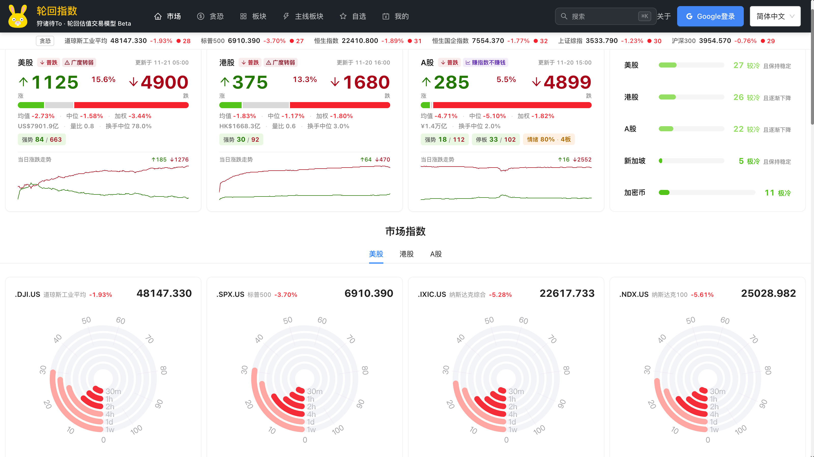
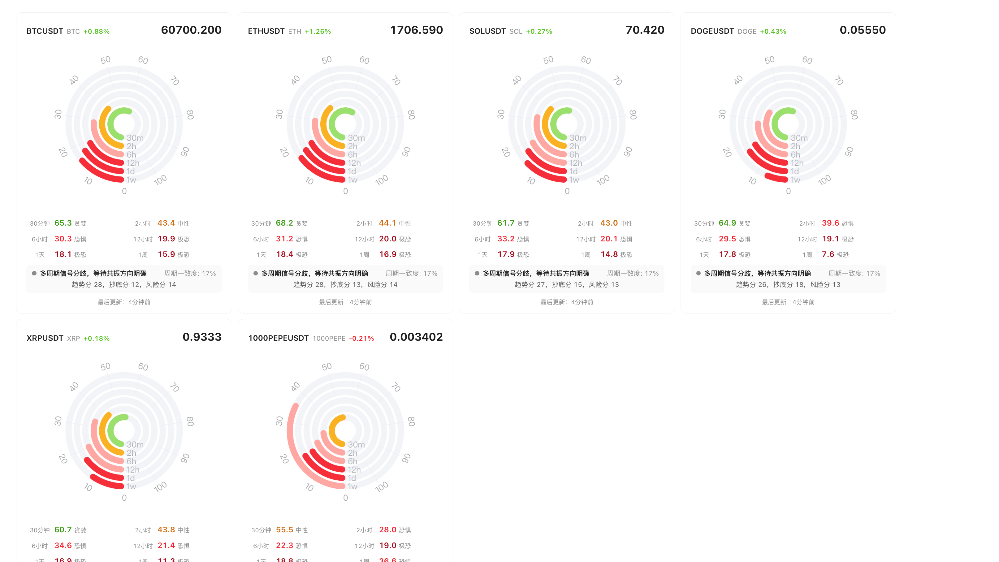
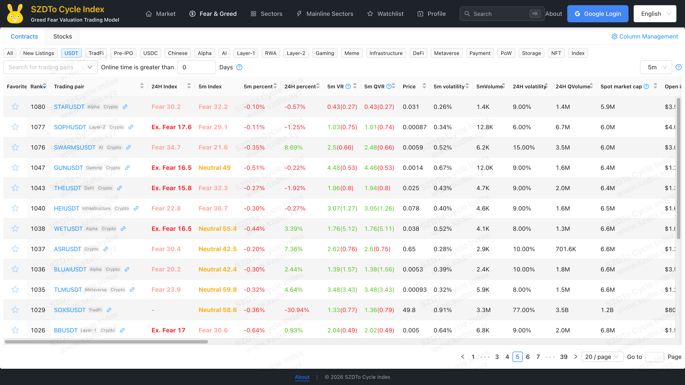
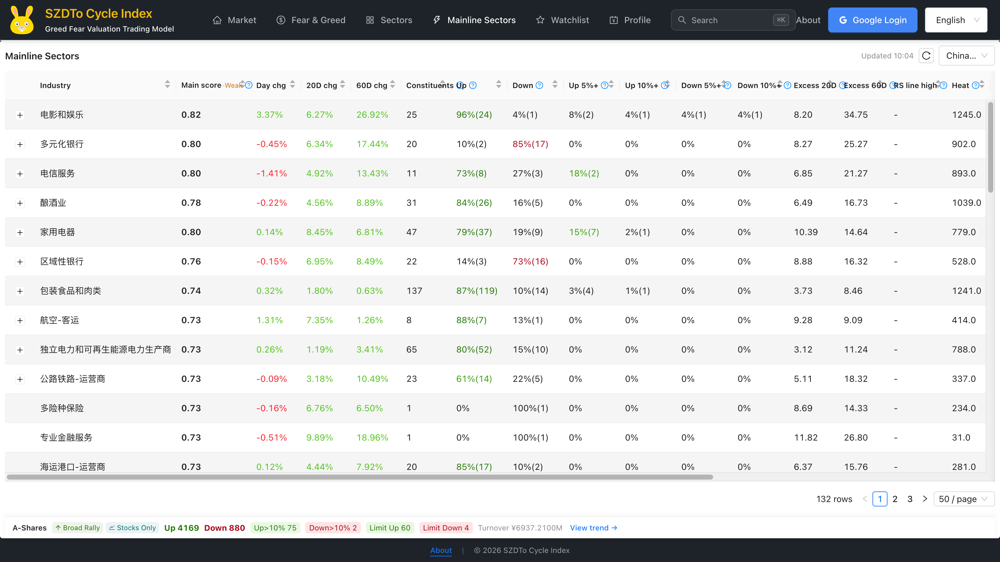

# SZDTo Cycle Index · 轮回指数

**市场情绪量化终端** — Multi-market sentiment quant terminal

> 在线体验：**https://www.szdto.xyz/** ｜ 介绍页：**https://cycleindex-szdto.github.io/**

## 这是什么？

轮回指数（SZDTo Cycle Index）是一个面向交易者的市场情绪量化终端，覆盖 **美股、港股、A 股与加密货币** 四大市场。

与只有一个日级数值的普通恐惧贪婪指数不同，轮回指数同时给出 **30 分钟、1 小时、2 小时、4 小时、1 天、1 周** 六个窗口的情绪值，并计算周期一致度、趋势分、抄底分与风险分，帮助识别短期恐慌与中期趋势的背离。

## 核心功能

| 功能 | 说明 |
|---|---|
| 🎯 恐惧贪婪指数 | 六周期多窗口情绪值 + 周期一致度 / 趋势分 / 抄底分 / 风险分 |
| 📈 专业 K 线终端 | 美股 / 港股 / A 股 / 加密货币，多指标副图，关联财务报表与贪恐评级 |
| 🔥 合约贪恐排行 | 24H / 5m 双周期评级排行，全市场合约一览 |
| 🧭 轮回盘 & 主线板块 | 130+ 行业主线强度排行：涨跌结构、强势股 TOP3、资金流净额 |
| 📊 市场宽度 & 温度 | 涨跌家数结构、宽度趋势曲线、情绪温度计与历史走势 |
| 🔍 全局搜索 | ⌘K 唤起，股票 / ETF / 合约 / 页面跨市场秒达 |
| ⚙️ 策略回测 | 服务端直连行情数据回测：买卖信号状态与收益追踪 |

## 截图

| 市场总览 | 轮回盘 |
|---|---|
|  |  |

| 恐惧贪婪指数 | 主线板块 |
|---|---|
|  |  |

## 关于本仓库

本仓库是产品的**官方介绍页**（静态站点，GitHub Pages 托管），
支持中文 / 繁体 / 英文三语（跟随浏览器语言自动切换，可手动切换）。

- 介绍页：https://cycleindex-szdto.github.io/
- 产品站：https://www.szdto.xyz/
- 本仓库代码：`index.html`（零依赖单文件）+ `images/`（三语言实截素材）

## License

介绍页内容（文案与截图）版权所有 © 2026 SZDTo Cycle Index。